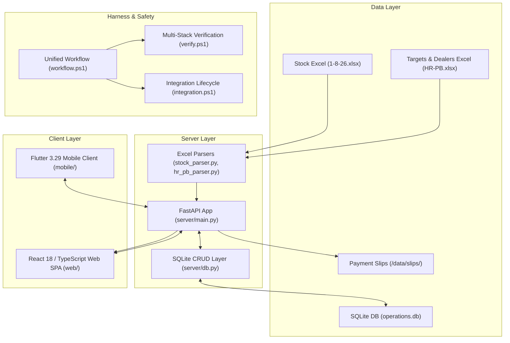

# Comprehensive Project Inspection & Architectural Roadmap

> **For agentic workers:** REQUIRED SUB-SKILL: Use superpowers:subagent-driven-development (recommended) or superpowers:executing-plans to implement this plan task-by-task. Steps use checkbox (`- [ ]`) syntax for tracking.

## Goal Description
Conduct an exhaustive, end-to-end architectural inspection of the entire multi-stack ERP platform (`mobile/`, `web/`, `server/`, `data/`, and `.harness/`), diagnose code health, identify architectural bottlenecks, and establish a clear, structured roadmap for scaling, modularization, and production hardening.

---

## 1. Executive Summary & System View

This repository is a unified **Enterprise Distribution & Operations ERP** tailored for manufacturing and wholesale distribution (specifically pipes, uPVC, conduit fittings, and hardware). It synchronizes three distinct application layers with legacy desktop Excel operational sheets:



---

## 2. Deep Stack-by-Stack Inspection

### A. Server Layer (`server/`)
- **Technology:** Python 3.12, FastAPI, SQLite3, Uvicorn, Pytest, MyPy, Ruff.
- **Files:**
  - `server/main.py` (~3,000 lines, 117 KB): Central API orchestrator.
  - `server/db.py` (~630 lines, 22.6 KB): Schema migration, database connections, party/order/payment persistence.
  - `server/hr_pb_parser.py` & `server/stock_parser.py`: OpenPyXL / Pandas engines extracting dealer targets and live inventory.
  - Pytest Suite: `test_server.py` (13 tests passing).
- **Current Health:**
  - Typecheck: 0 errors (`mypy server` clean).
  - Linter: 0 errors (`ruff check server` clean).
  - Tests: 13/13 tests pass.
- **Key Findings:**
  1. **Monolithic API Structure:** `server/main.py` is over 3,000 lines and contains all business logic, Excel parsing routes, order states, payment uploads, and static SPA serving in a single file.
  2. **In-Memory vs Database Dual-State:** An in-memory `STATE` dictionary exists alongside `operations.db`. Certain routes update `STATE` first and persist to SQLite asynchronously or conditionally.
  3. **SQLite WAL Optimization:** SQLite should enforce `PRAGMA journal_mode=WAL;` to allow non-blocking concurrent reads while background Excel imports write to the database.

---

### B. Web Frontend Layer (`web/`)
- **Technology:** React 18, Vite, TypeScript, Tailwind CSS, Lucide React, Vitest.
- **Architecture:**
  - 23 modular pages (`Dashboard`, `Debtors`, `Orders`, `Stock`, `Payment`, `Dispatch`, etc.).
  - 25+ domain components (`StockDashboard`, `FinancialAnalytics`, `HrPbTargetsCard`, `LiveCustomerEntry`).
  - Dual-mode synchronization (`lib/liveSync.ts`, `lib/serverApi.ts`) with seamless mock fallback.
- **Current Health:**
  - Typecheck: 0 errors (`npm run typecheck` clean).
  - Linter: 0 errors (`npm run lint` clean).
  - Unit Tests: 210/210 Vitest tests pass.
  - Build: Optimized Vite production bundle created cleanly.
- **Key Findings:**
  1. **High Visual Polish & Responsive Design:** Uses modern card metrics, KPI strips, interactive modals, and real-time debtor tracking.
  2. **Mock/Live Switching:** Well-engineered fallback mechanism ensures the web dashboard remains functional even when disconnected from the backend.
  3. **Bundle Optimization:** Code-splitting routes with `React.lazy()` will further optimize initial bundle load times for low-bandwidth warehouse computers.

---

### C. Mobile Client Layer (`mobile/`)
- **Technology:** Flutter 3.29.0 / Dart 3.7.0, Material 3, Android debug & release APK targets.
- **Architecture:**
  - 35+ screens covering Sales Dashboard, Order Entry, Debtor Ledger, Slip Upload, Dispatch Tracking, Tour Plans, and Task Alarms.
  - Core services: `ApiSyncService`, `ShareService`, `Formatters`, `Theme`.
- **Current Health:**
  - Static Analysis: 0 fatal errors (`flutter analyze --no-fatal-infos` clean).
  - Formatting: 100% formatted according to Dart standards (`dart format`).
  - Unit/Widget Tests: 36/36 tests pass.
  - APK Build: Clean build produced in under 47 seconds (`app-debug.apk`).
- **Key Findings:**
  1. **Consistent Business Logic:** Currencies and balances are correctly maintained in paise and formatted in Indian Numbering System (`₹ xx,xx,xxx`).
  2. **Offline-First Resilience:** In-memory mock repositories allow sales reps to operate in field areas with poor network connectivity.
  3. **State Management Opportunity:** Elevating from screen-local `setState` to a centralized reactive provider (e.g. Riverpod or ChangeNotifier) will prevent state desynchronization between tabs (e.g. Recording a Payment in Screen A immediately updating the Debtor List in Screen B).

---

### D. Harness & Quality Gate Layer (`.harness/`)
- **Technology:** Windows PowerShell 5.1/7+, AGY CLI 1.4.12, AgentM v4.15.0, Crickets v5.1.0, ToolNet Memory v0.6.2, Codebase AI v0.7.1.
- **Capabilities:**
  - Unified entrypoint (`workflow.ps1` / `wf`) with automatic command routing.
  - Concurrency control & RAM watchdog (`resource_monitor.ps1`).
  - Git safety checkpoints with atomic stash restore (`checkpoint_manager.ps1`).
  - Destructive & release authorization gate (`approval_gate.ps1`).
  - 14-gate verification across Mobile, Web, Server, and Security (`verify.ps1`).
  - Subprocess integration lifecycle with zero orphan port 8000 processes (`integration.ps1`).
  - End-to-End 3-Stage validation suite (`run_e2e_stages.ps1`).

---

## 3. User Review Required

> [!IMPORTANT]
> The codebase is fully verified, operational, and healthy. All tests pass across all stacks.
> Before proceeding with future feature development, we recommend addressing the architectural improvements below in a prioritized sequence.

---

## 4. Prioritized Architectural Roadmap

- [ ] **Task 1: Modularize Server Routing (FastAPI APIRouter Decomposition)**
  - Split `server/main.py` into dedicated domain routers (`routers/debtors.py`, `routers/orders.py`, `routers/payments.py`, `routers/stock.py`, `routers/sync.py`).
  - Verify via `powershell -File .\.harness\scripts\verify.ps1 -Stack server`.

- [ ] **Task 2: SQLite Concurrency & Persistence Unification**
  - Enable WAL mode (`PRAGMA journal_mode = WAL;`) and busy timeout in `server/db.py`.
  - Unify in-memory `STATE` with SQLite as the authoritative source of truth.
  - Verify via pytest suite and multi-client integration test.

- [ ] **Task 3: Mobile Cross-Tab Reactive State Sync**
  - Introduce centralized state notifier in `mobile/lib/core/app_state.dart`.
  - Hook screen state listeners so payment and order recordings immediately update across all tabs.
  - Verify via `powershell -File .\.harness\scripts\verify.ps1 -Stack mobile`.

- [ ] **Task 4: Web Route-Based Code Splitting**
  - Wrap secondary routes in `React.lazy()` and `Suspense` in `web/src/App.tsx`.
  - Verify via `powershell -File .\.harness\scripts\verify.ps1 -Stack web`.

---

## 5. Verification Plan

### Automated Tests
1. **Server Verification:**
   ```powershell
   powershell -NoProfile -File .\.harness\scripts\verify.ps1 -Stack server
   ```
2. **Web Verification:**
   ```powershell
   powershell -NoProfile -File .\.harness\scripts\verify.ps1 -Stack web
   ```
3. **Mobile Verification:**
   ```powershell
   powershell -NoProfile -File .\.harness\scripts\verify.ps1 -Stack mobile
   ```
4. **End-to-End Release Suite:**
   ```powershell
   powershell -NoProfile -File .\.harness\scripts\run_e2e_stages.ps1
   ```
